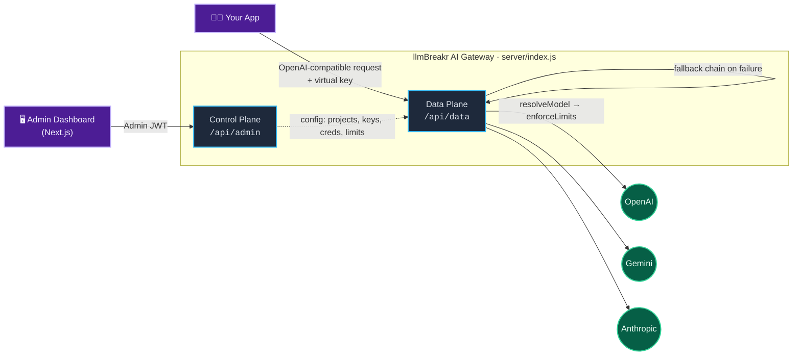
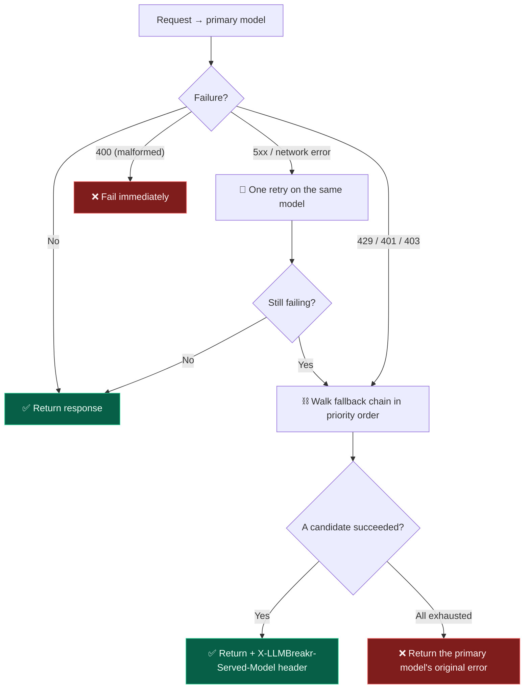

<div align="center">

# 🚪 llmBreakr AI Gateway

**One OpenAI-compatible API in front of OpenAI, Gemini &amp; Anthropic** — virtual keys, per-project routing, automatic fallback, limits &amp; audit logs. Self-hosted, no third-party SaaS in your traffic path.

[](LICENSE)
[](#prerequisites)
[](#tech-stack)
[](https://hub.docker.com/r/yashbansal0412/llmbreakr-ai-gateway)
[](CONTRIBUTING.md)

[Features](#-features) · [Architecture](#-architecture) · [Quick start](#-getting-started) · [API](#-api-quick-reference) · [Fallback](#-automatic-fallback) · [Roadmap](#-roadmap)

</div>

---

## ✨ Features

| | |
| --- | --- |
| 🔌 **Unified chat API** | One OpenAI-compatible endpoint (`/v1/chat/completions`, streaming included) that proxies to OpenAI, Gemini, and Anthropic today — more providers on the way (see [Roadmap](#-roadmap)) |
| 🔑 **Virtual keys** | Issue scoped API keys per project/consumer instead of sharing raw provider keys, with an approval workflow before a key goes live |
| 🗂️ **Projects &amp; model routing** | Group consumers into projects and control exactly which provider models each project is allowed to call |
| 🔁 **Automatic fallback** | Configure an ordered chain of alternate models per project model; a provider outage, rate limit, or bad credential automatically retries the next model in the chain instead of failing |
| 📊 **Limits &amp; quotas** | Request-rate and budget enforcement per project, checked on every request before it reaches the provider |
| 📝 **Usage &amp; audit logs** | Every chat request and every admin action is logged for later review |
| 🛡️ **RBAC** | Role/permission-based access control for admin users |
| 🖥️ **Admin dashboard** | Next.js UI for managing projects, virtual keys, provider credentials, models, users/roles, and logs |

---

## 🏗️ Architecture



<details>
<summary><b>📁 Repository layout</b></summary>

```
server/
  admin/       # control plane: auth, projects, virtual keys, credentials, audit logs
  dataplane/   # the actual LLM proxy: chat requests, limit enforcement, model resolution
  providers/   # OpenAI / Gemini / Anthropic adapters
  middlewares/ # shared auth (admin JWT) middleware
  models/      # Sequelize models
  scripts/     # one-off DB migration scripts (see "Database" below)
web/           # Next.js admin dashboard
```

</details>

Both the admin API and the dataplane proxy run in the same Express app (`server/index.js`), mounted at two separate base paths:

| Base path    | Purpose                                                     | Auth |
| ------------ | ---------------------------------------------------------- | ---- |
| `/api/admin` | Control plane — everything you configure from the dashboard | Admin JWT (`Authorization: Bearer <access_token>`) |
| `/api/data`  | Data plane — the actual LLM proxy your applications call    | Virtual key (`Authorization: Bearer <virtual_key>`) |

`admin/*` and `dataplane/*` are logically separate layers (controller → service → validation) even though they share one process — the data plane is the hot path that forwards chat traffic to providers, and stays out of the admin request/response cycle.

---

## 🚀 Getting started

### Prerequisites

 &nbsp;  &nbsp; 

No `DB_HOST`? The server falls back to an embedded SQLite file (`server/data/llmbreakr.sqlite`) automatically — fine for trying it out or single-instance use. Set `DB_HOST`/`DB_PORT`/`DB_NAME`/`DB_USER`/`DB_PASSWORD` to point at MySQL for production instead.

No `REDIS_HOST`? Same idea — an in-process cache stands in for Redis (rate limits, budgets, and the virtual-key cache just live in this process's memory instead, and reset on restart). Set `REDIS_HOST` to a real Redis instance for production or anything running more than one instance.

Nothing set at all — no `.env`, no `DB_HOST`, no `REDIS_HOST`, no secrets? The server still boots: SQLite + the in-process cache kick in, `JWT_SECRET`/`CREDENTIAL_ENCRYPTION_KEY` are generated and saved to `server/data/.secrets.json` so they survive restarts, and a super admin is seeded at `admin@llmbreakr.local` / `admin` (change the password after logging in). Set any of these explicitly and they take priority over the generated/default values.

<details open>
<summary><b>1 · Server (admin API + gateway)</b></summary>

```bash
cd server
npm install
npm run dev   # zero-config: no .env needed. To customize, cp .env.example .env first — see server/.env.example
```

</details>

<details>
<summary><b>2 · Admin dashboard</b></summary>

```bash
cd web
npm install
cp .env.local.example .env.local
npm run dev
```

The dashboard defaults to talking to the server at `http://localhost:4000` (`EXPRESS_API_URL` in `web/.env.local`).

</details>

<details>
<summary><b>🐳 Or: run everything with Docker</b></summary>

The whole gateway (API + admin dashboard) ships as a **single image**, built from the one `Dockerfile` at the repo root — it runs both processes in one container (`start.sh` starts `server/index.js` on :4000 and the dashboard on :3000, and stops the container if either one dies).

`docker-compose.yml` only runs this one `app` container, and needs no `.env` at all to start — the database, cache, and secrets all fall back to in-container/in-process/auto-generated defaults (see above). Set `DB_HOST`/`DB_PORT`/`DB_NAME`/`DB_USER`/`DB_PASSWORD` for MySQL, `REDIS_HOST`/`REDIS_PORT` for Redis, and `JWT_SECRET`/`CREDENTIAL_ENCRYPTION_KEY`/`SUPER_ADMIN_EMAIL` for production, once you're past trying it out.

```bash
docker compose up --build   # zero-config. cp .env.example .env first to customize any of it.
```

Gateway API → `http://localhost:4000`, dashboard → `http://localhost:3000`. Both processes share one `.env` — since they run in the same container, `EXPRESS_API_URL` just points at `http://localhost:4000` (baked into the image), so there's no cross-container config to keep in sync.

</details>

<details>
<summary><b>📦 Running the published image (no clone needed)</b></summary>

Every release publishes to both **Docker Hub** (`yashbansal0412/llmbreakr-ai-gateway`) and **GHCR** (`ghcr.io/yashb007/llmbreakr-ai-gateway`) via [`.github/workflows/docker-publish.yml`](.github/workflows/docker-publish.yml). `docker-compose.yml` pulls from Docker Hub by default. To run it on a server without cloning the repo, you only need `docker-compose.yml` and a real `.env`:

```bash
curl -O https://raw.githubusercontent.com/yashb007/llmBreakr-ai-gateway/main/docker-compose.yml
curl -O https://raw.githubusercontent.com/yashb007/llmBreakr-ai-gateway/main/.env.example
cp .env.example .env   # fill in DB/JWT/admin secrets
IMAGE_TAG=1.0.2 docker compose pull
IMAGE_TAG=1.0.2 docker compose up -d
```

`docker-compose.yml`'s `app` service declares both `build: .` (used when you run `docker compose build`/`up --build` locally, e.g. during development) and `image: yashbansal0412/llmbreakr-ai-gateway:${IMAGE_TAG:-latest}` (used for `pull`/`up` without `--build`). Omit `IMAGE_TAG` to run `latest`. The `main`-branch URLs above always fetch the current compose file; pin to a release tag (e.g. `/v1.0.2/docker-compose.yml`) instead if you want that file to stop changing under you between deploys.

Prefer GHCR instead? Swap the `image:` line in `docker-compose.yml` to `ghcr.io/yashb007/llmbreakr-ai-gateway:${IMAGE_TAG:-latest}` — both registries get the same tags on every release.

</details>

<details>
<summary><b>🏷️ Releasing</b></summary>

```bash
git tag v1.0.0
git push origin v1.0.0
```

Pushing a `vX.Y.Z` tag triggers CI to build the root `Dockerfile` and push it to GHCR as both `X.Y.Z` and `latest`. Requires GHCR to be public (or the server to `docker login ghcr.io`) — a brand-new package defaults to private on first push, so make it public once in the repo's Packages settings after the first release.

Also mirrors to Docker Hub (`yashbansal0412/llmbreakr-ai-gateway`) once `DOCKERHUB_USERNAME` and `DOCKERHUB_TOKEN` are set as repo secrets — until then that step is skipped, not failed, so GHCR publishing isn't blocked on it. To enable it:

1. On Docker Hub, under Account Settings → Security, generate an access token (not your password).
2. In this repo: Settings → Secrets and variables → Actions → New repository secret. Add `DOCKERHUB_USERNAME` = `yashbansal0412` and `DOCKERHUB_TOKEN` = the access token.
3. Next tag push publishes to both registries automatically — no workflow changes needed.

</details>

<details>
<summary><b>🗄️ Database</b></summary>

On every boot, `connectClients()` (`server/config/client.js`) runs `sequelize.sync()` to create/update tables from `server/models`, then seeds a super admin using `SUPER_ADMIN_EMAIL` / `SUPER_ADMIN_NAME` from `server/.env` — so a fresh database just works on first `npm run dev`, no manual migration step needed.

There's no formal migration framework beyond that — one-off schema changes that `sync()` can't express (backfills, column renames, etc.) live as scripts under `server/scripts/` (e.g. `add-project-budget-column.js`). Run new scripts manually with `node server/scripts/<script>.js` after pulling changes that add one. If you ever need to reset the super admin password, see `server/scripts/reset-admin-password.js`.

</details>

---

## 📡 API quick reference

<details open>
<summary><b>🔐 Authenticate as an admin</b></summary>

```bash
curl -X POST http://localhost:4000/api/admin/auth/login \
  -H "Content-Type: application/json" \
  -d '{"email": "you@example.com", "password": "..."}'
# -> { access_token, refresh_token, ... }
```

Use the super admin account (`SUPER_ADMIN_EMAIL` from `server/.env`) to log in for the first time, then create projects, provider credentials, and virtual keys from the dashboard or via `/api/admin/*`.

</details>

<details open>
<summary><b>💬 Call the gateway with a virtual key</b></summary>

```bash
curl -X POST http://localhost:4000/api/data/v1/chat/completions \
  -H "Authorization: Bearer <virtual_key>" \
  -H "Content-Type: application/json" \
  -d '{
    "model": "gpt-4o-mini",
    "messages": [{"role": "user", "content": "Hello"}]
  }'
```

Every request runs through `virtualKeyAuth → resolveModel → enforceLimits` before it's forwarded to the provider — the key must be approved and active, the model must be allowed for the key's project, and the project's rate/budget limits must not be exceeded. `model` must be a raw provider model id (e.g. `gpt-4o-mini`, `gemini-1.5-pro`, `claude-3-5-sonnet-...`) that's been enabled for that project. Set `"stream": true` for an SSE stream. If a fallback chain is configured for the requested model and the primary provider fails, the response includes an `X-LLMBreakr-Served-Model` header naming whichever model actually served it.

</details>

**Other useful endpoints:** `/api/admin/projects` · `/api/admin/virtual-keys` · `/api/admin/provider-creds` · `/api/admin/models` · `/api/admin/logs` · `/api/admin/usage` · `/api/admin/audit-logs` · `/api/admin/project-model-fallbacks`

---

## 🔁 Automatic fallback

When a model's provider fails, the gateway can automatically retry the same request against a different, pre-configured model instead of just returning an error.



- 🔄 **One retry, then fallback** — a transient failure (any 5xx, or a network error with no status at all) gets one retry on the *same* model first. If that also fails, or the failure is a rate limit (`429`) or a bad credential (`401`/`403`), the gateway walks the fallback chain in priority order, trying each candidate once.
- 🚫 **A `400` never retries or falls back** — a malformed request is the same broken request on every provider, so it fails immediately.
- 🎯 **The caller always sees the primary model's original error if every candidate is exhausted** — not the last fallback's error, since that's not what was actually asked for.
- 🌊 **Fallback only applies before any response bytes reach the client.** For streaming requests, that means only if the provider connection itself fails to establish — never mid-stream, since silently swapping providers after tokens have already been sent would corrupt the response.
- ⚙️ **Configure a chain**: `POST /api/admin/project-model-fallbacks` with `{ project_id, primary_project_model_id, fallback_project_model_id, priority }` — both sides must already be in that project's model allowlist. `GET`/`PATCH`/`DELETE` on the same route manage/reorder/remove entries. In the dashboard: a project's detail page → **Allowed models** → **Fallbacks** on each model row.
- 👀 **Observability**: `request_logs` gains `requested_model` (only set when a fallback actually served the request) and `fallback_attempt` (`0` = primary, `1`+ = which fallback).

---

## 🧰 Tech stack


- Node.js / Express, MySQL (via Sequelize), Redis
- Next.js 15 / React 19 / Tailwind for the admin dashboard

---

## 🗺️ Roadmap

> Provider support today is **OpenAI, Gemini, and Anthropic**. More providers (and more gateway features beyond routing/limits/logging) are planned — contributions adding new provider adapters under `server/providers/` are welcome.

- 🔓 This repo is the self-hosted, MIT-licensed gateway. A managed SaaS version and additional enterprise capabilities are planned separately — self-hosting the full open-source gateway will always remain supported.
- 🧭 Smart routing (proactively spreading traffic across multiple valid models/credentials on every request, not just on failure) is under consideration as a follow-up to automatic fallback.

---

## 🤝 Contributing

See [CONTRIBUTING.md](CONTRIBUTING.md).

## 📄 License

[](LICENSE) &nbsp; MIT — see [LICENSE](LICENSE).
